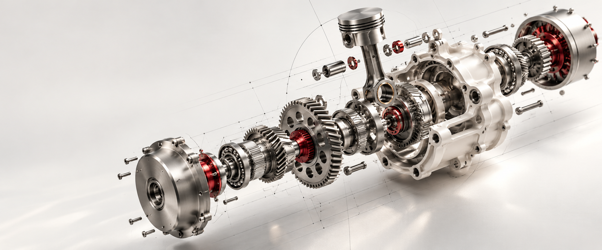
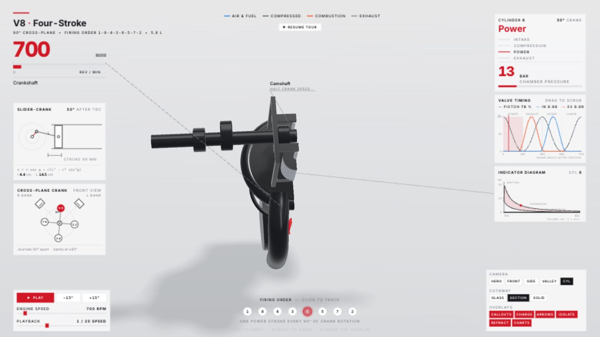
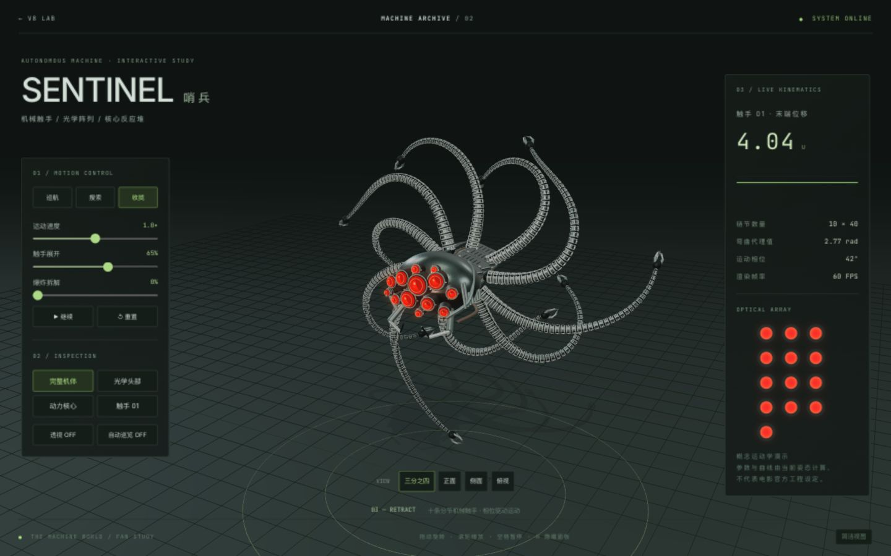

<p align="center"></p>
<h1 align="center">三维拆解 · Teardown for Codex</h1>
<p align="center"><strong>让原理动起来，让结构看得见。</strong><br>一套可直接调用的技能，两套可离线运行的交互成品：V8 八缸发动机与哨兵机器人。</p>
<p align="center"><a href="README.md">简体中文</a> · <a href="文档/英文说明v1.1.md">English</a> · <a href="https://tuanziding.github.io/v8-interactive-simulator/gallery.html">在线作品集</a></p>
<p align="center"><a href="LICENSE"></a>  </p>
<p align="center"><code>Codex Skill</code> · <code>Three.js</code> · <code>Offline HTML</code> · <code>可编辑源码</code></p>
<p align="center"><a href="#use-cases">使用场景</a> ｜ <a href="#showcase">成果展示</a> ｜ <a href="#quick-start">快速开始</a> ｜ <a href="#capabilities">能力状态</a> ｜ <a href="#contribute">参与共创</a></p>
<p align="center"><sub>顶部为 AI 概念封面；下方两幅为真实浏览器截图。V8 是教学模型，哨兵是非官方程序化同人模型。</sub></p>

---

<a id="use-cases"></a>
## 使用场景

| 你想做什么 | 直接入口 |
| --- | --- |
| 观察四冲程、曲轴、气门与压力曲线 | `npm run generate -- v8 --out ./output-v8` |
| 查看哨兵巡航、机械触手、部件隔离和拆解 | `npm run generate -- sentinel --out ./output-sentinel` |
| 同时获得两套离线成品与可编辑源码 | `npm run generate -- all --out ./output-all` |
| 制作其他机器的原理演示 | 调用 `$teardown-codex`，提供对象和参考；由 Agent 建模与核验 |

三个命令是随附模板的确定性构建，不是从一句话自动恢复任意 CAD。新机器仍由 Agent 依据技能工作流编写模型。

<a id="showcase"></a>
## 成果展示

<table><tr><td width="50%"><a href="https://tuanziding.github.io/v8-interactive-simulator/"></a><br><strong>V8 · 八缸发动机</strong><br>四冲程、透明剖切、单缸追踪、转速与实时仪表。</td><td width="50%"><a href="https://tuanziding.github.io/v8-interactive-simulator/sentinel.html"></a><br><strong>Sentinel · 哨兵</strong><br>空间巡航、400 个链节、13 枚镜头、爆炸拆解和透视。</td></tr></table>

[直接体验 V8](https://tuanziding.github.io/v8-interactive-simulator/) · [直接体验哨兵](https://tuanziding.github.io/v8-interactive-simulator/sentinel.html) · [成品下载](https://github.com/TUANZIDING/v8-interactive-simulator/releases/tag/v1.0.0)

<a id="quick-start"></a>
## 快速开始

需要 Node.js 20+、npm 和 Git。普通网页生成不需要 Python、ffmpeg、API key 或 Claude CLI。

### 安装为 Codex 技能

```sh
git clone https://github.com/TUANZIDING/teardown-codex.git "${CODEX_HOME:-$HOME/.codex}/skills/teardown-codex"
cd "${CODEX_HOME:-$HOME/.codex}/skills/teardown-codex"
npm run setup
```

若目录已存在，请先查看本地修改，再更新原副本，不要覆盖。新开 Codex 聊天后调用：

> 使用 $teardown-codex，生成 V8 和哨兵两个离线交互演示，输出到我的项目目录，并保留可编辑源码。

> 使用 $teardown-codex，以哨兵模板为基础，修改触手数量与运动模式，保留参数面板和部件隔离。

### 命令行直接生成

在技能仓库根目录运行：

```sh
npm run generate -- all --out ./output-all
# 或单独生成：
npm run generate -- v8 --out ./output-v8
npm run generate -- sentinel --out ./output-sentinel
```

输出目录必须尚不存在，生成器拒绝覆盖已有作品。`--out` 相对当前工作目录解析；脚本也可用绝对路径从其他目录调用。

```text
output-all/
├── v8.html · sentinel.html          # 可直接离线打开的成品
├── source/                         # 可编辑源码、构建器、锁文件
├── LICENSE · THIRD-PARTY-NOTICES.txt
└── README.md                       # 再次构建说明
```

生成后打开 HTML。编辑后重新构建：

```sh
cd output-all/source
npm ci
node sims/build.mjs v8-live sentinel-live
```

结果位于 `source/teardown-out/dist/`。浏览器需支持 WebGL；推荐宽屏，手机布局也可用。

## 工作流与目录

参考与参数 → 统一运动模型 → 几何与交互 → 离线构建 → 浏览器核验 → 按用户要求发布。

| 位置 | 用途 |
| --- | --- |
| `SKILL.md` / `agents/openai.yaml` | Codex 技能入口与显示信息 |
| `scripts/generate-v1.1.mjs` | 一键生成与源码导出 |
| `templates/sentinel-live/` | 哨兵模型、运动求解、交互面板和测试 |
| `upstream/` | 保留上游 V8、工具与许可证 |
| `文档/模型与修改指南v1.1.md` | 修改 V8 / 哨兵时按需阅读 |
| `来源记录v1.1.md` | 上游与本次扩展出处 |

<a id="capabilities"></a>
## 能力状态

| 状态 | 范围 |
| --- | --- |
| 已验证 | 三种生成模式、非仓库工作目录、中文及空格路径、拒绝覆盖、离线 HTML 打包 |
| 已验证 | 哨兵 480 组链节长度 / 连续性参数检查，以及巡航位移、朝向与冻结时间检查 |
| 已实际操作 | V8 剖切与步进；哨兵巡航、暂停、拆解、隔离，桌面与窄屏布局 |
| 明确边界 | V8 压力曲线是简化教学模型；哨兵不包含电影官方资产、真实动力学或碰撞求解 |
| 按需扩展 | 新机器建模、影音导出；并非本次一键生成入口已实现的功能 |

```sh
npm test
```

<details><summary>可选视频与浏览器工具</summary>

上游保留捕获与音效工具。仅在需要时安装浏览器：`cd upstream && npx playwright install chromium`。视频另需 ffmpeg；程序化音频另需 Python。哨兵实时页面目前没有独立的逐帧 `render(t)` 视频导出契约，不要把实时页面直接宣称为可确定性录像模板。

</details>

<a id="contribute"></a>
## 参与共创

欢迎提交有参考依据的机构、新运动模式或交互问题。请附浏览器、复现步骤和截图。[Issues](https://github.com/TUANZIDING/teardown-codex/issues) · [更新记录](CHANGELOG.md) · [来源](来源记录v1.1.md)

## 许可与引用

代码与文档采用 [MIT](LICENSE)。上游来自 [elvarofficial/teardown](https://github.com/elvarofficial/teardown) 与 [whaleyxbt/claude-motion](https://github.com/whaleyxbt/claude-motion)。字体、three.js 与音效归属随源文件及生成产物保留。哨兵造型受《黑客帝国》启发，非官方项目，相关角色及影视权利归原权利方；代码许可不授予电影品牌权利。引用格式见 [CITATION.cff](CITATION.cff)。

<p align="center"><strong>三维拆解 · Teardown for Codex</strong><br><a href="https://github.com/TUANZIDING">TUANZIDING</a> · MIT · v1.1.0</p>
