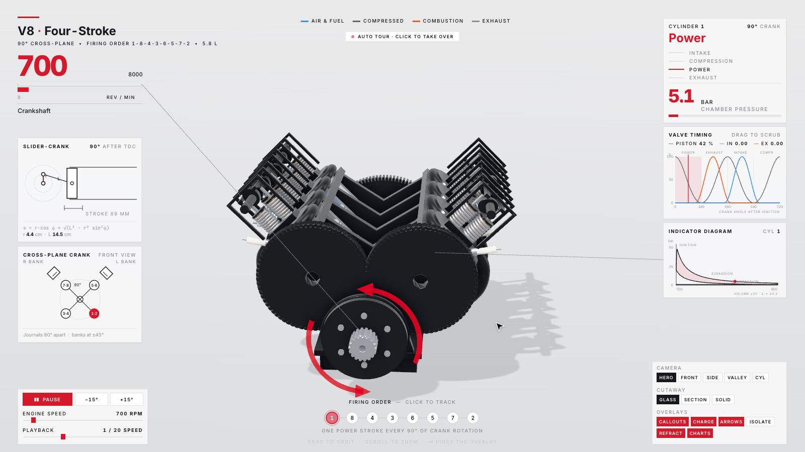

<p align="center"></p>

<h1 align="center">三维拆解 · Teardown for Codex</h1>
<p align="center"><strong>See how it works. Take it apart.</strong><br>A Codex skill for interactive 3D teardowns, cutaways and offline explanations.</p>
<p align="center"><a href="../README.md">简体中文</a> · <a href="英文说明v1.0.md">English</a></p>
<p align="center"><a href="../LICENSE"></a></p>
<p align="center"><code>Codex</code> · <code>Interactive 3D</code> · <code>Offline HTML</code> · <code>Three.js</code></p>
<p align="center"><a href="#use-cases">Use cases</a> ｜ <a href="#showcase">Showcase</a> ｜ <a href="#quick-start">Quick start</a> ｜ <a href="#capabilities">Capability status</a> ｜ <a href="#contribute">Contribute</a></p>
<p align="center"><sub>Cover: AI-generated concept artwork; not a runtime screenshot or engineering drawing.</sub></p>

---

<a id="use-cases"></a>
## Use cases

| Goal | Starting point |
| --- | --- |
| Explain pistons, valves and combustion | V8 reference |
| Explain a retracting mechanism | Cessna landing-gear reference |
| Explore walking linkages | Strandbeest reference |

New objects require modeling; this is an agent workflow, not automatic CAD reconstruction.

<a id="showcase"></a>
## Showcase



Real screenshot of the upstream V8 example, built locally and rendered offline with software WebGL. The original example interface is English. [Download the HTML](../示例/发动机示例v1.0.html) using GitHub’s download button, then open it in a WebGL-capable browser. GitHub file preview does not execute the page.

<a id="quick-start"></a>
## Quick start

Requires Node.js 20+, npm and Git. If the destination already exists, update your existing checkout instead of overwriting it.

```sh
git clone https://github.com/TUANZIDING/teardown-codex.git "${CODEX_HOME:-$HOME/.codex}/skills/teardown-codex"
cd "${CODEX_HOME:-$HOME/.codex}/skills/teardown-codex/upstream"
npm ci
npx playwright install chromium
```

Open a new Codex chat and invoke:

> Use $teardown-codex to create an interactive gearbox explanation with rotation, exploded view, speed control and part labels. Deliver an offline HTML page.

Build the included reference from the upstream directory:

```sh
node sims/build.mjs v8-live
```

`teardown-out/dist/v8-live.html`

## Workflow

Reference → parameters → shared state model → geometry & controls → offline build → visual review

<a id="capabilities"></a>
## Capability status

| Status | Scope |
| --- | --- |
| Verified | Skill schema, locked dependency installation, V8 build, offline load and screenshot |
| Included | Upstream models, capture tools and procedural audio engine |
| Not fully tested | All controls, mobile layout, hardware GPU performance and complete video/audio export |
| Workflow guidance | Chinese output, versioned filenames, reference tracking and educational-model disclosures |

<details>
<summary>Technical configuration</summary>

`TEARDOWN_OUT` sets the output directory; `CHROMIUM` selects a browser binary. Video additionally requires ffmpeg; procedural audio requires Python 3. See [upstream guide](../upstream/SKILL.md).

</details>

<a id="contribute"></a>
## Contribute

Contributions welcome: new mechanisms, reference-backed parameters, Chinese UI and interaction tests.

[Skill](../SKILL.md) · [Provenance](../来源记录v1.0.md) · [Issues](https://github.com/TUANZIDING/teardown-codex/issues)

---

Adapted from [elvarofficial/teardown](https://github.com/elvarofficial/teardown), built on [whaleyxbt/claude-motion](https://github.com/whaleyxbt/claude-motion). Upstream code remains intact under MIT; original sound credits are retained in [sound sources](../upstream/sfx/samples/SOURCES.md).

<p align="center"><a href="https://github.com/TUANZIDING">TUANZIDING</a> · <a href="../LICENSE">MIT</a> · v1.0</p>
